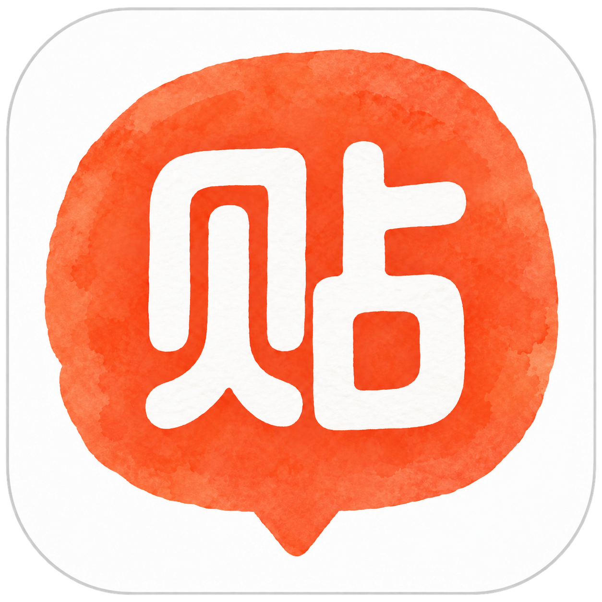
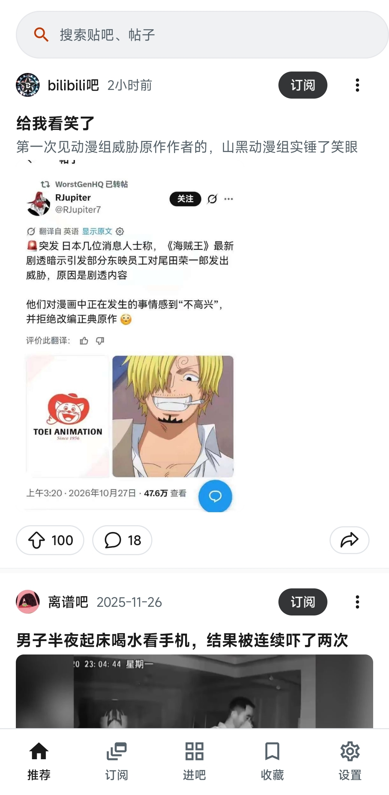
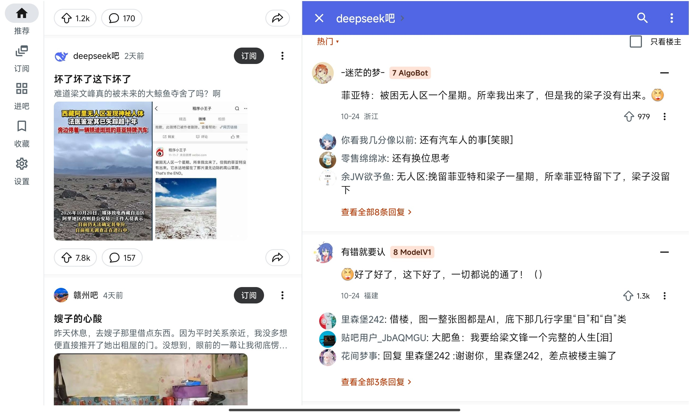

<p align="center">
  
</p>

<h1 align="center">ReTieba</h1>

<p align="center"><b>Pure Tieba Reader</b><br />免登录的 Android 贴吧阅读客户端</p>

<p align="center"><a href="#截图">截图</a> · <a href="#功能">功能</a> · <a href="#安装">安装</a> · <a href="#构建">构建</a> · <a href="#来源与许可">来源与许可</a></p>

ReTieba 基于 [TiebaPure-Android](https://github.com/infinityf4p/TiebaPure-Android) 改造，参考 Reddit 的信息流布局。打开就能看帖，也可以把常看的贴吧和用户加入本地订阅，集中浏览他们的帖子。

## 截图

<p align="center">
  
  <br /><sub>推荐首页</sub>
</p>

<p align="center">
  
  <br /><sub>平板：推荐列表与帖子详情</sub>
</p>

## 功能

**阅读**

- 推荐首页、贴吧与帖子搜索、吧内列表及排序，阅读帖子和楼中楼。
- 本地订阅贴吧、关注用户；订阅流支持来源筛选、时间范围和排序。
- 按发布时间、最后回复时间或热度排序；热度仅比较已加载帖子。
- 图片查看与保存、视频播放，支持帖子离线阅读。

**本地与外观**

- 收藏、浏览历史和阅读位置恢复；离线保存可单独管理。
- 手势返回并恢复此前的阅读位置；管理本地缓存。
- 用户、贴吧与关键词屏蔽，最近浏览支持长按移除。
- 浅色／深色主题，字号与行距调整，内置 Plex 并支持导入 TTF／OTF 字体。
- 手机、平板与分屏布局。

应用只读公开内容，点赞显示真实数量。订阅、关注和收藏保存在本机，不与贴吧账号同步。

当前版本通过关闭登录、发帖、回复等入口、切断相关调用，并在应用 API 客户端拦截认证和写请求，实现匿名只读。上游的部分账号、消息和写操作源码仍保留在工程中，尚未全面清理。

## 安装

支持 **Android 6.0（API 23）及以上**。首个公开版本为 **1.0.0-rc.3 预发布版**，在 [GitHub Releases](https://github.com/npc0451/TiebaPure-Android/releases/tag/v1.0.0-rc.3) 下载 APK。安装与升级方式见[安装说明](docs/INSTALL.md)，更新内容见[版本说明](docs/releases/1.0.0-rc.3.md)。

## 构建

使用 Kotlin 与 Jetpack Compose。构建需要 JDK 17、Android SDK 36 和 Build Tools 36.0.0。

```bash
./gradlew assembleDebug
```

Windows 使用 `gradlew.bat`。项目结构、测试和签名说明见[开发文档](docs/DEVELOPMENT.md)与[发布指南](docs/RELEASING.md)。

## 来源与许可

ReTieba 修改自 [infinityf4p/TiebaPure-Android](https://github.com/infinityf4p/TiebaPure-Android)，沿用 [GPL-3.0-only](LICENSE)。自 2026 年 10 月起在上游 `d7e3988` 基础上改造，以只读阅读和本地订阅为重点。

感谢上游作者提供的网络、媒体、离线阅读和自适应布局实现，也保留上游对 [TiebaLite](https://github.com/HuanCheng65/TiebaLite) 与 [aiotieba](https://github.com/lumina37/aiotieba) 的致谢。第三方组件与字体许可见 [THIRD_PARTY_NOTICES.md](THIRD_PARTY_NOTICES.md) 和 [LICENSES](LICENSES)。


本项目与百度、贴吧官方或 Reddit 无隶属、授权或认可关系。相关名称与标识归各自权利人所有。
